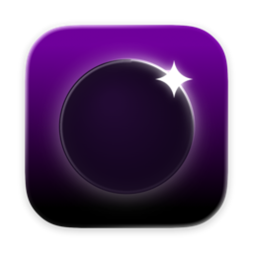

<p align="center">
  
</p>

<h1 align="center">Glimmer</h1>

<p align="center">Your gaming PC, on your Mac.</p>

<p align="center">
  <a href="https://se7enbrc.github.io/glimmer/">Website</a> ·
  <a href="https://github.com/Se7enbrc/glimmer/releases/latest">Download for Mac</a> ·
  <a href="#install">Homebrew</a> ·
  <a href="docs/SHORTCUTS.md">Shortcuts</a> ·
  <a href=".github/SUPPORT.md">Get help</a>
</p>

<p align="center">
  <a href="https://github.com/Se7enbrc/glimmer/actions/workflows/verify.yml"></a>
  <a href="https://github.com/Se7enbrc/glimmer/actions/workflows/codeql.yml"></a>
  <a href="https://github.com/Se7enbrc/glimmer/releases/latest"></a>
  <a href="#install"></a>
  <a href="https://github.com/Se7enbrc/homebrew-glimmer"></a>
  <a href="docs/RELEASE.md"></a>
  <a href="https://scorecard.dev/viewer/?uri=github.com/Se7enbrc/glimmer"></a>
  <a href="https://www.bestpractices.dev/en/projects/15346"></a>
  <a href="renovate.json"></a>
  <a href="LICENSE"></a>
</p>

<p align="center">
  
</p>

Glimmer is a Mac-native client for
[Sunshine](https://github.com/LizardByte/Sunshine). It streams games from your
PC using Apple's video, audio and input frameworks, with a SwiftUI and AppKit
interface. macOS 26 or later, Apple Silicon. Free, open source, and always free.

## What you get

- **Video:** H.264, HEVC and AV1, 8- and 10-bit, real HDR10, up to 4K 240 Hz.
- **Pacing:** the display locks to the stream, tuned against per-frame
  telemetry.
- **Audio:** stereo, 5.1 and 7.1, with spatial audio and AirPods head tracking.
- **Controllers:** Xbox, DualSense and other pads, with rumble, gyro, touchpad
  and adaptive triggers.
- **Mouse and keyboard:** raw 1:1 aim with the acceleration curve removed.
- **Wi-Fi:** a helper that stops AirDrop's radio from interrupting the stream.
- **The Mac side:** menu bar, mini player, Wake on LAN, Shortcuts, Siri,
  Spotlight and a `glimmer` command.

No accounts, no analytics: Glimmer talks only to your PC and its update feed.
[Every feature in detail](docs/FEATURES.md).

## Install

```bash
brew tap se7enbrc/glimmer
brew trust --tap se7enbrc/glimmer   # Homebrew requires this for third-party taps
brew install --cask glimmer
```

Or the notarized `.dmg` from
[Releases](https://github.com/Se7enbrc/glimmer/releases). Glimmer updates
itself. Your PC needs Sunshine and a display that can show your Mac's exact
mode; [set up the PC](docs/HOST_SETUP.md), then see
[the install guide](docs/INSTALL.md) for the Wi-Fi helper, verifying a download
and audio tips.

## Documentation

| Guide                                   | What's in it                                             |
| --------------------------------------- | -------------------------------------------------------- |
| [Features](docs/FEATURES.md)            | Video, pacing, audio, controllers, input, Wi-Fi, the Mac |
| [Install](docs/INSTALL.md)              | Homebrew, the download, the Wi-Fi helper, audio tips     |
| [Setting up the PC](docs/HOST_SETUP.md) | Sunshine and a virtual display                           |
| [Shortcuts](docs/SHORTCUTS.md)          | Keyboard and controller shortcuts, copy and paste        |
| [Command line](docs/COMMAND_LINE.md)    | `glimmer`, and moving over from moonlight-qt             |
| [Audio on macOS](docs/AUDIO.md)         | Voice chat, AirPods and volume recovery                  |
| [Security](docs/SECURITY.md)            | The Wi-Fi helper, signing and verifying a download       |
| [Contributing](docs/CONTRIBUTING.md)    | Building, testing and sending a change                   |
| [Architecture](docs/ARCHITECTURE.md)    | How the engine fits together                             |
| [Roadmap](docs/ROADMAP.md)              | What's next                                              |

## Build

Xcode 26.6 or later. Its one third-party library is
[Sparkle](https://sparkle-project.org), for updates.

```bash
git clone https://github.com/Se7enbrc/glimmer.git
cd glimmer
make app
```

[Contributing](docs/CONTRIBUTING.md) covers tests, signing and installing.

## Why not Moonlight

Moonlight is excellent and Glimmer would not exist without it. Glimmer focuses
on macOS: its streaming engine is written in Swift and uses VideoToolbox,
AVAudioEngine and GameController, with SwiftUI and AppKit for the interface. The
menu bar, Mini Player, Shortcuts and display-matched presets are built around
how you use a Mac.

## Support

Free software, spare time.
[Sponsor it on GitHub](https://github.com/sponsors/Se7enbrc) if it makes your
setup better.

## License

GPLv3. Copyright © 2026 ugfugl.io. See [LICENSE](LICENSE).

The transport is ported from
[moonlight-common-c](https://github.com/moonlight-stream/moonlight-common-c) and
[moonlight-qt](https://github.com/moonlight-stream/moonlight-qt), both GPLv3, so
Glimmer is too. Full acknowledgment in [CREDITS.md](CREDITS.md).
