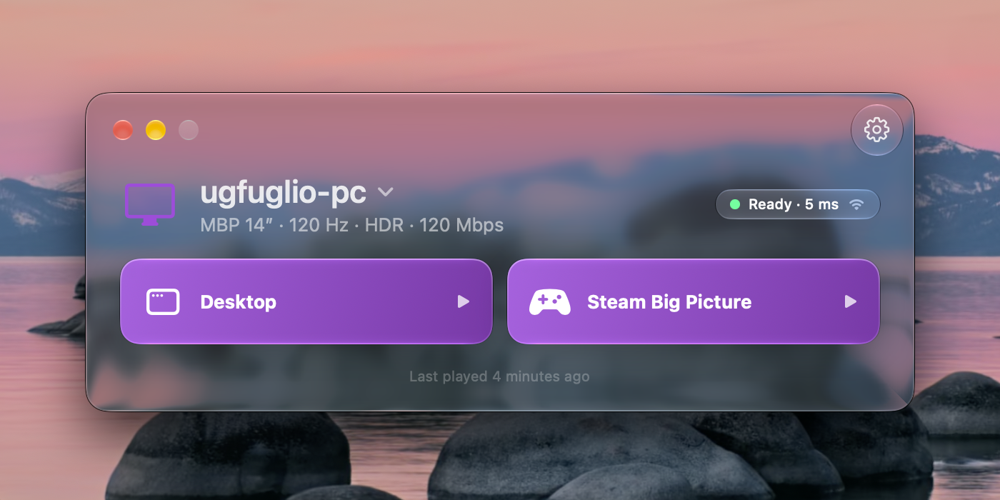

# Glimmer help

**The other room. Right here.**

Glimmer is a Mac-native client for
[Sunshine](https://github.com/LizardByte/Sunshine). It streams games from your
own PC to your Mac. macOS 26 or later, Apple silicon. Free, now and always.

## Make yourself at home

New here? Install Glimmer, then set up the PC.



{% column width="50%" %}

**[Install Glimmer](INSTALL.md)**

Homebrew, the download, and the Wi-Fi helper.



{% column width="50%" %}

**[Set up the PC](HOST_SETUP.md)**

Sunshine and a display that matches your Mac.







{% column width="50%" %}

**[What Glimmer can do](FEATURES.md)**

Video, audio, controllers, and more.



{% column width="50%" %}

**[Keyboard and controller shortcuts](SHORTCUTS.md)**

Stop a stream, get the pointer back, and copy and paste.







{% column width="50%" %}

**[Audio and voice chat](AUDIO.md)**

AirPods, microphone choices, and volume recovery.



{% column width="50%" %}

**[Use the command line](COMMAND_LINE.md)**

Pair, stream, and wake the PC with `glimmer`.





Working on Glimmer itself? Start with [Contribute to Glimmer](CONTRIBUTING.md)
and [How Glimmer works](ARCHITECTURE.md).
