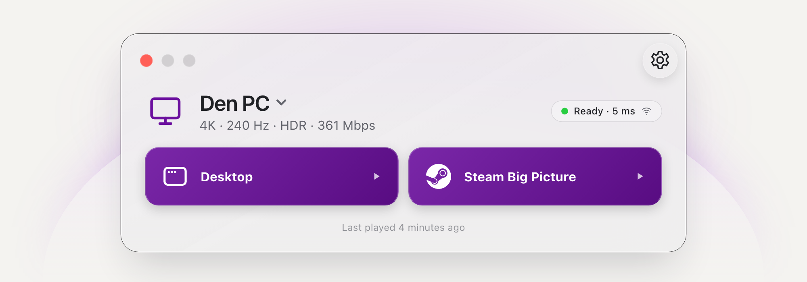

# Play your PC games on Mac, iPhone and iPad

Pair with Sunshine on your PC, choose a game and play. Glimmer brings the same
launcher, controller layouts and running-game controls to Mac, iPhone and iPad.
The iPhone and iPad app is available through TestFlight now; the App Store
release is coming soon.

<picture>
  <source media="(prefers-color-scheme: dark)" srcset="assets/launcher-art-dark.png">
  
</picture>

| Need       | Go here                                                              |
| ---------- | -------------------------------------------------------------------- |
| Setup      | [Requirements](REQUIREMENTS.md) · [FAQ](FAQ.md)                      |
| Controls   | [Guides](FEATURES.md) · [Automation](AUTOMATION.md)                  |
| Help       | [Troubleshooting](guides/TROUBLESHOOTING.md) · [Updates](UPDATES.md) |
| Your data  | [Privacy](PRIVACY.md) · [Security](SECURITY.md)                      |
| Contribute | [Developer guide](CONTRIBUTING.md) · [Roadmap](ROADMAP.md)           |

Next: [install Glimmer and pair your PC](GETTING_STARTED.md).
